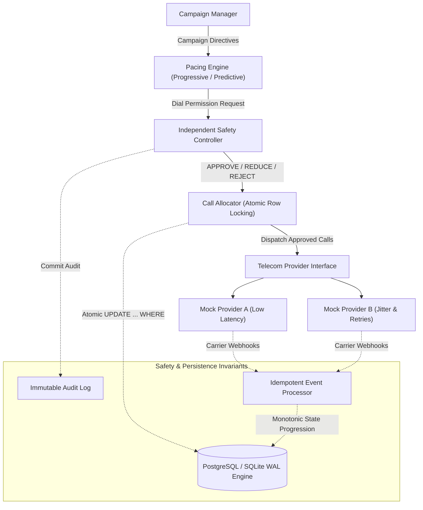

# NEXDIAL — Intelligent Contact Center & Predictive SmartDialer

[](https://fastapi.tiangolo.com)
[](https://react.dev)
[](https://www.typescriptlang.org)
[](https://tailwindcss.com)
[](https://www.postgresql.org)
[](https://opensource.org/licenses/MIT)

> **NEXDIAL** is an enterprise-grade SmartDialer and predictive contact center platform built with a clean modular monolith architecture. It improves call-center agent utilization while mathematically guaranteeing **zero abandoned connected calls** through an **Independent Safety Controller**.

---

## 1. Core Architectural Pipeline



> **CRITICAL ARCHITECTURAL INVARIANT:**
> The Predictive Pacing Engine **never directly initiates telecom calls**. It can only request permission from the Safety Controller. The Safety Controller independently validates available agents, active calls, ringing calls, reserved agents, carrier health, and safety capacity.

---

## 2. Key Features

- **Progressive Dialing (1:1 Ratio):** One available agent yields at most one outbound call.
- **Statistical Predictive Pacing:** Closed-form mathematical pacing combining Bayesian smoothed answer rates ($\hat{p}$), near-term agent release estimation, and risk buffers.
- **Independent Safety Controller:** Evaluates capacity against real-time database state; issues `APPROVE`, `REDUCE`, `REJECT`, or `FALLBACK_TO_PROGRESSIVE` rulings.
- **Concurrency & Atomic Locking:** Atomic conditional updates (`UPDATE agents SET status='RESERVED' WHERE status='AVAILABLE'`) prevent double-allocations across simultaneous workers.
- **Telecom Carrier Simulation:** Provider A (high speed, low latency) and Provider B (carrier jitter, timeouts, out-of-order events).
- **Circuit Breakers:** `CLOSED`, `OPEN`, and `HALF_OPEN` states protect upstream carriers from retry storms.
- **Idempotent Event Processor:** Deduplicates carrier webhooks by `event_id` and enforces monotonic call state progression.
- **Interactive Simulation Lab:** 4 presets (Scenarios A, B, C, D) with real-time speed, pause, resume, step-forward, and WebSocket telemetry streaming.
- **Chaos & Failure Injection:** 8 real-time failure injection modes (worker crash, carrier outage, agent drop, duplicate event, out-of-order event, answer collapse, latency spike, concurrency race).
- **Enterprise Dark Theme:** Custom design system inspired by Linear, Stripe, and Datadog (`#090D18`, `#101827`, `#151F30`, `#7C6CFF`, `#20C997`, `#F5B942`, `#FF5C70`).

---

## 3. Technology Stack

- **Frontend:** React 18, TypeScript, Vite, Tailwind CSS, Framer Motion, Recharts, Lucide React.
- **Backend:** Python 3.13, FastAPI, SQLAlchemy 2.0 (Async), Pydantic v2, WebSockets, aiosqlite / asyncpg.
- **Persistence:** SQLite WAL (development & zero-setup testing) / PostgreSQL 16 (production container).
- **Testing:** Pytest, pytest-asyncio, tabulate (concurrency, progressive, predictive, safety, and circuit breaker test suites).

---

## 4. Quick Start & Setup

### Prerequisites
- Python 3.11+
- Node.js 18+ & npm
- Docker (optional)

### Option A: Local Development Setup (Quickest)

1. **Clone the repository:**
   ```bash
   git clone https://github.com/your-username/nexdial.git
   cd nexdial
   ```

2. **Setup Backend:**
   ```bash
   # Create virtual environment
   python -m venv backend/venv

   # Activate virtualenv
   # On Windows:
   .\backend\venv\Scripts\Activate.ps1
   # On Linux/macOS:
   source backend/venv/bin/activate

   # Install dependencies
   pip install -r backend/requirements.txt

   # Seed database (creates realistic agents, borrowers, and past calls)
   $env:PYTHONPATH="backend"  # Linux/macOS: export PYTHONPATH=backend
   python backend/app/seed.py

   # Start FastAPI backend server (Port 8000)
   uvicorn app.main:app --host 0.0.0.0 --port 8000 --reload
   ```

3. **Setup Frontend:**
   ```bash
   cd frontend
   npm install
   npm run dev
   ```
   Open your browser to: **http://localhost:3000** (or http://localhost:5173).

---

### Option B: Docker Compose (Full PostgreSQL Stack)

```bash
docker-compose up --build
```
- Frontend UI: `http://localhost:3000`
- Backend API & Docs: `http://localhost:8000/docs`
- PostgreSQL: `localhost:5432`

---

## 5. Automated Test Suite

NEXDIAL includes 15 automated test specifications covering concurrency, state machines, safety validation, and circuit breakers:

```bash
# Run all tests with pytest
$env:PYTHONPATH="backend"
backend/venv/Scripts/pytest backend/tests -v
```

### Verified Test Categories:
- `test_progressive_dialer.py`: 1:1 allocation ratio, agent release upon call completion/failure.
- `test_concurrency.py`: Mathematical proof of atomic reservation (1 winner, 49 conflicts).
- `test_safety_controller.py`: Decision gating, capacity capping, carrier circuit rejection, and progressive fallback.
- `test_predictive_pacing.py`: Statistical formula evaluation, Bayesian smoothing, and buffer bounds.
- `test_event_handling_idempotency.py`: Monotonic call state hierarchy and duplicate suppression.
- `test_provider_circuit_breaker.py`: `CLOSED` $\to$ `OPEN` $\to$ `HALF_OPEN` state machine transitions.
- `test_worker_recovery.py`: Stale reservation recovery (>15s) and reconciliation of orphaned resources.

---

## 6. Empirical Performance Benchmarks

Run the empirical benchmark load-testing script:
```bash
$env:PYTHONPATH="backend"
python backend/load_testing/benchmark.py
```

### Actual Measured Results:
```
+----------------+---------------------+----------------------------+--------------------------+-------------------+------------------------+----------------------------+
|   Agents Count |   DB Seed Time (ms) |   Alloc Throughput (ops/s) |   Avg Alloc Latency (ms) |   Contention Wins |   Contention Conflicts |   Event Throughput (ops/s) |
|----------------+---------------------+----------------------------+--------------------------+-------------------+------------------------+----------------------------|
|            100 |                20.2 |                      152.0 |                     6.58 |                 1 |                     49 |                      114.2 |
|          1,000 |                64.0 |                      121.9 |                     8.20 |                 1 |                     49 |                      116.7 |
|         10,000 |               651.4 |                       42.1 |                    23.76 |                 1 |                     49 |                      113.0 |
+----------------+---------------------+----------------------------+--------------------------+-------------------+------------------------+----------------------------+
```

---

## 7. Documentation Deep Dives

- [System Architecture Specification](docs/architecture.md)
- [Architecture Decision Records (ADRs)](docs/architecture-decision-record.md)
- [Agent State Machine Specification](docs/agent-state-machine.md)
- [Call State Machine Specification](docs/call-state-machine.md)
- [Statistical Predictive Pacing Engine](docs/predictive-pacing.md)
- [Independent Safety Controller](docs/safety-controller.md)
- [Failure Handling & Chaos Resilience](docs/failure-handling.md)
- [Scaling Strategy & Bottleneck Analysis](docs/scaling-strategy.md)

---

## 8. License

This project is licensed under the MIT License.
