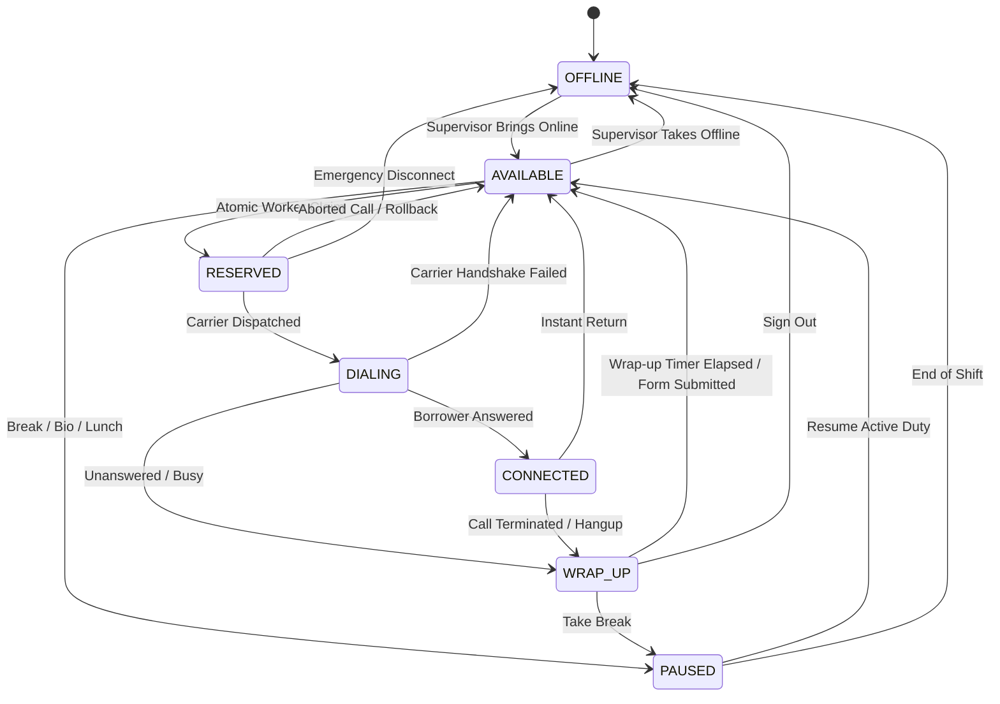

# Agent State Machine Specification — NEXDIAL

## 1. State Machine Definition

The Agent entity follows a strictly governed finite state machine. Transitions are validated in `app.services.agent_service` to ensure illegal transitions (e.g. reserving an agent who is already in `CONNECTED` or `OFFLINE` status) throw validation errors.



---

## 2. Transition Rules Matrix

| Current State | Allowed Next States | Trigger / Condition |
| :--- | :--- | :--- |
| `OFFLINE` | `AVAILABLE` | Agent logs into console and signals readiness. |
| `AVAILABLE` | `RESERVED`, `PAUSED`, `OFFLINE` | Atomically locked by Call Allocator, paused by agent, or taken offline. |
| `RESERVED` | `DIALING`, `AVAILABLE`, `OFFLINE` | Carrier initiation starts (`DIALING`) or call allocation aborts (`AVAILABLE`). |
| `DIALING` | `CONNECTED`, `WRAP_UP`, `AVAILABLE` | Borrower answers (`CONNECTED`) or call fails/busy (`WRAP_UP`/`AVAILABLE`). |
| `CONNECTED` | `WRAP_UP`, `AVAILABLE` | Either party hangs up conversation. |
| `WRAP_UP` | `AVAILABLE`, `PAUSED`, `OFFLINE` | Post-call disposition logged. Agent ready for next customer. |
| `PAUSED` | `AVAILABLE`, `OFFLINE` | Agent returns from break or signs out. |

---

## 3. Concurrency Protection & Zero Double-Booking

To guarantee that two concurrent dialing workers can **never reserve the same agent**, NEXDIAL uses atomic conditional database operations:

```python
stmt = (
    update(Agent)
    .where(
        and_(
            Agent.id == agent_id,
            Agent.status == AgentStatus.AVAILABLE
        )
    )
    .values(
        status=AgentStatus.RESERVED,
        last_status_change=func.now()
    )
)
result = await db.execute(stmt)
await db.commit()

acquired = (result.rowcount > 0)
```

### Mathematical Guarantee:
If Worker 1 and Worker 2 concurrently execute this update on Agent $A_1$:
1. The database transaction engine serializes the write lock on row $A_1$.
2. The first transaction evaluates `status == 'AVAILABLE'` (True), mutates status to `'RESERVED'`, commits, and returns `rowcount = 1` (`acquired = True`).
3. The second transaction evaluates `status == 'AVAILABLE'` (now False), performs zero updates, and returns `rowcount = 0` (`acquired = False`).
4. Double reservation probability: **0.00%**. Verified empirically in automated concurrency tests (`tests/test_concurrency.py`).
