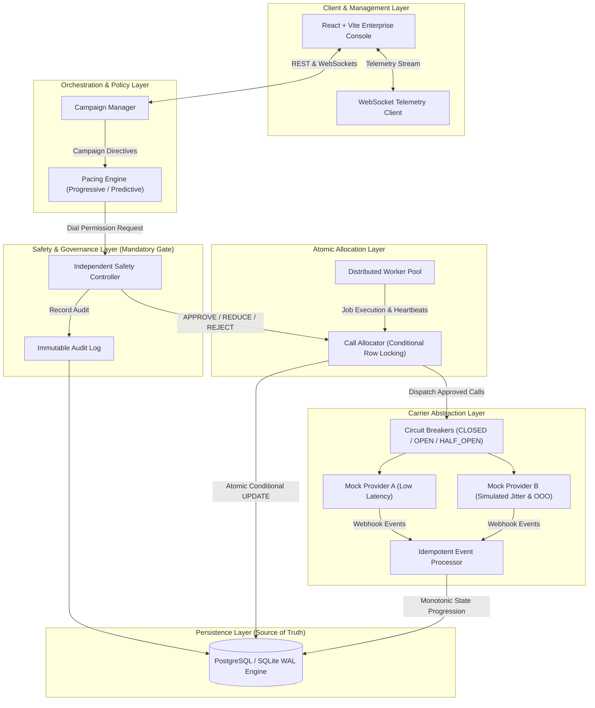
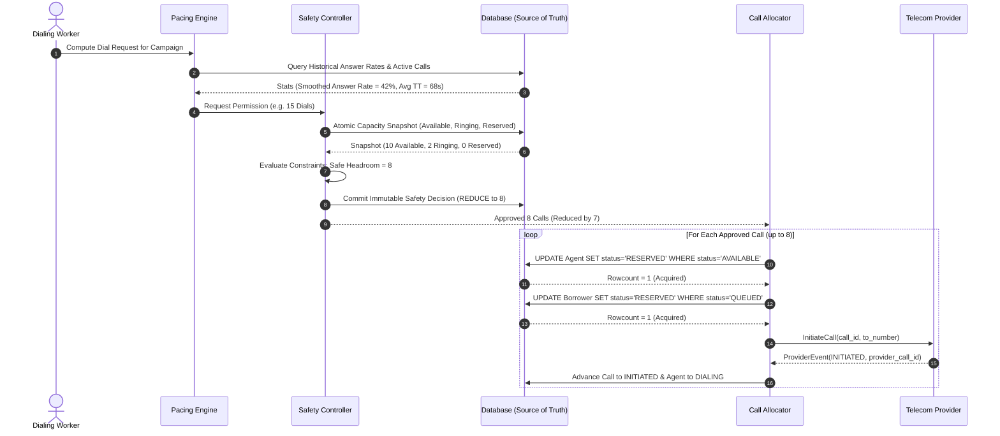

# System Architecture Specification — NEXDIAL

## 1. Architectural Overview

NEXDIAL is engineered as a **Clean Modular Monolith** designed for high-concurrency progressive dialing, predictive statistical pacing, and fault-tolerant telecom carrier orchestration.

The architecture enforces strict structural isolation: **The Predictive Pacing Engine is prohibited from initiating telephone calls directly.** It operates solely as an advisory component, submitting dial permission requests to an **Independent Safety Controller**.

---

## 2. Component Directory & Responsibilities

| Component | Module | Responsibility | Invariants |
| :--- | :--- | :--- | :--- |
| **Campaign Manager** | `app.services.campaign_service` | Defines campaign targets, max attempts, retry intervals, target abandon rate. | Never allows duplicate campaigns to process the same borrower simultaneously. |
| **Pacing Engine** | `app.services.pacing_engine` | Evaluates queue demand, smoothed answer rate, talk times, and near-term agent releases. | **Never dispatches telecom calls.** Only computes advisory requests. |
| **Safety Controller** | `app.services.safety_controller` | Evaluates system capacity directly from DB rows. Emits `APPROVE`, `REDUCE`, `REJECT`, `FALLBACK_TO_PROGRESSIVE`. | Zero borrower connects without an assigned agent. Bypassing is architecturally impossible. |
| **Call Allocator** | `app.services.call_allocator` | Transactionally binds agent and borrower using atomic SQL updates. Rolls back reservations on carrier initiation errors. | Never leaves an agent or borrower locked in `RESERVED` upon failure. |
| **Telecom Interface** | `app.services.telecom` | Standardizes outbound carrier APIs, manages Circuit Breakers per provider. | Protects carriers from cascading load when error rates spike. |
| **Event Processor** | `app.services.telecom.event_processor` | Deduplicates carrier webhooks by `event_id`. Enforces monotonic call state progression. | Older/late events can never regress a call from `COMPLETED` back to earlier states. |
| **Worker Pool** | `app.services.worker_pool` | Distributed worker simulation with leases, heartbeats, and stale reservation recovery. | Reconciles orphaned reservations (>15s) left by crashed workers without double dialing. |

---

## 3. The Five-Phase Allocation Sequence

