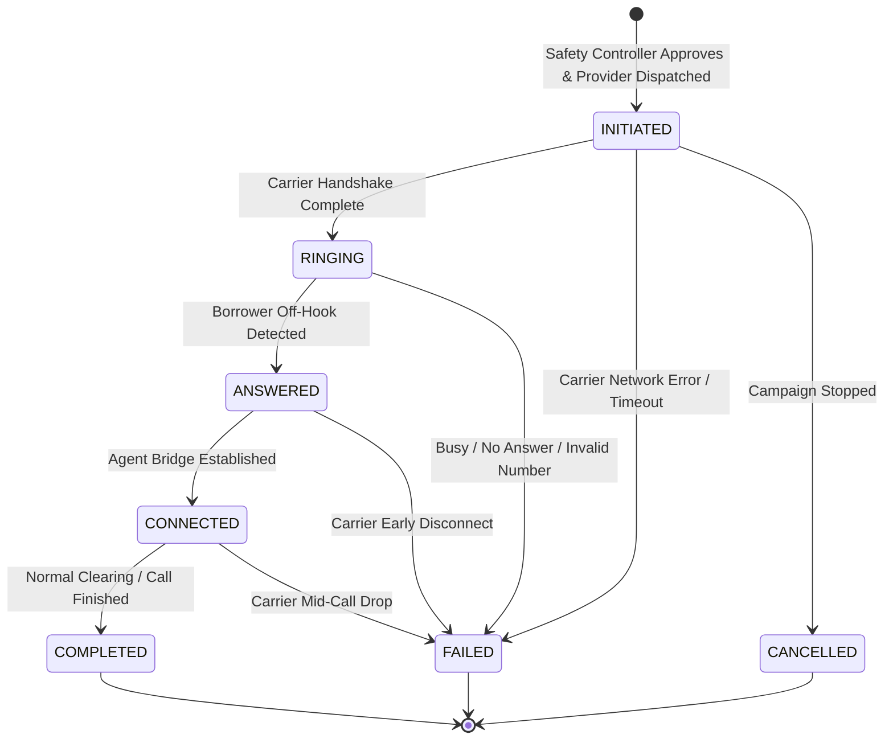

# Call State Machine Specification — NEXDIAL

## 1. Call State Progression

The Call entity models the physical telecom connection from outbound dial initiation through carrier ringing, borrower answer, agent bridge, and post-call completion.



---

## 2. Monotonic State Ranking & Idempotency Filter

Carrier webhook architectures inherently produce duplicate events and out-of-order packets over public networks. NEXDIAL enforces **monotonic state advancement** using numerical rank comparisons:

```python
STATE_RANK = {
    CallState.INITIATED: 1,
    CallState.RINGING: 2,
    CallState.ANSWERED: 3,
    CallState.CONNECTED: 4,
    CallState.COMPLETED: 5,
    CallState.FAILED: 5,
    CallState.CANCELLED: 5,
}
```

### Anomaly Scenarios & Defense:

#### Scenario A: Duplicate Webhook Events
```
Event 1: { id: "evt-01", type: "ANSWERED" } -> Applied (State becomes ANSWERED)
Event 2: { id: "evt-01", type: "ANSWERED" } -> Intercepted by Idempotency Filter (is_duplicate = True)
Result: Zero side-effects; suppressed secondary agent allocation.
```

#### Scenario B: Out-of-Order Webhook Delivery
```
Event 1: { id: "evt-02", type: "COMPLETED" } -> Applied (State becomes COMPLETED, Rank 5)
Event 2: { id: "evt-03", type: "RINGING" }   -> Received late (Rank 2)
Comparison: Incoming Rank (2) < Current Rank (5)
Result: Flagged as is_out_of_order = True; state regression strictly rejected.
```
