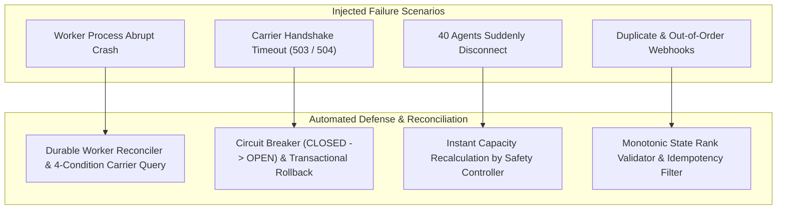
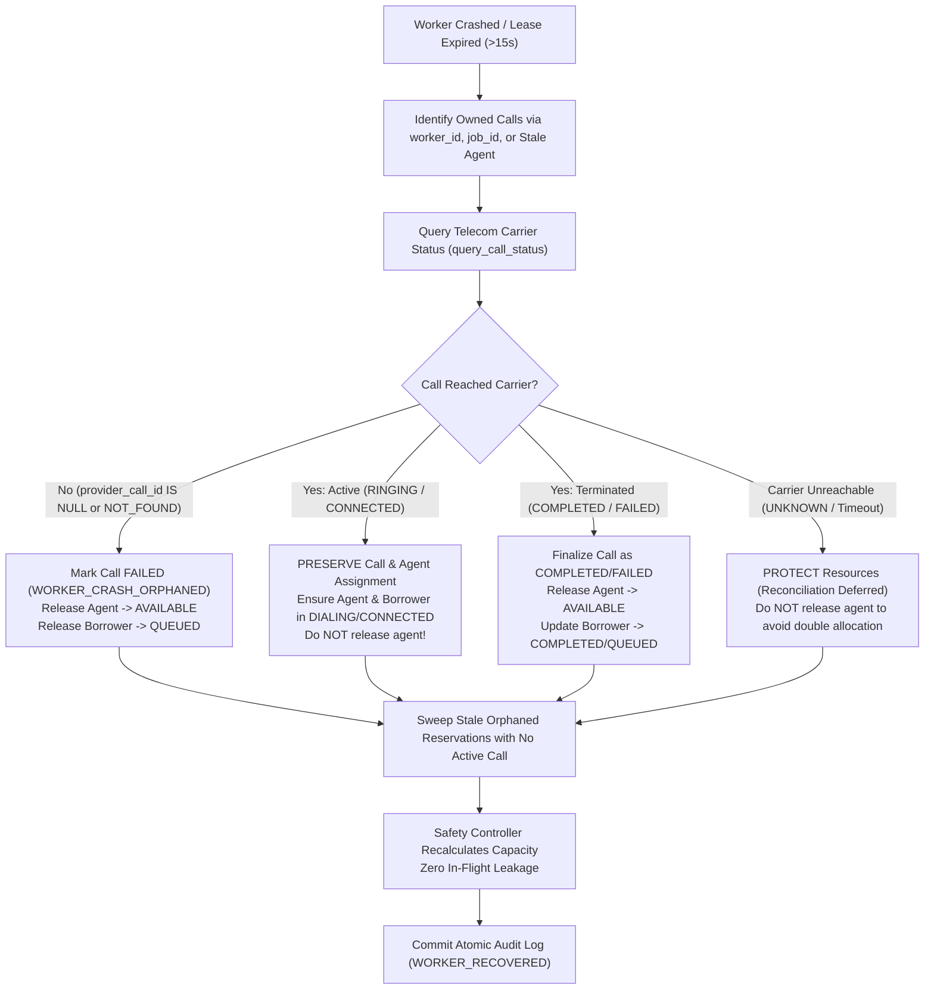
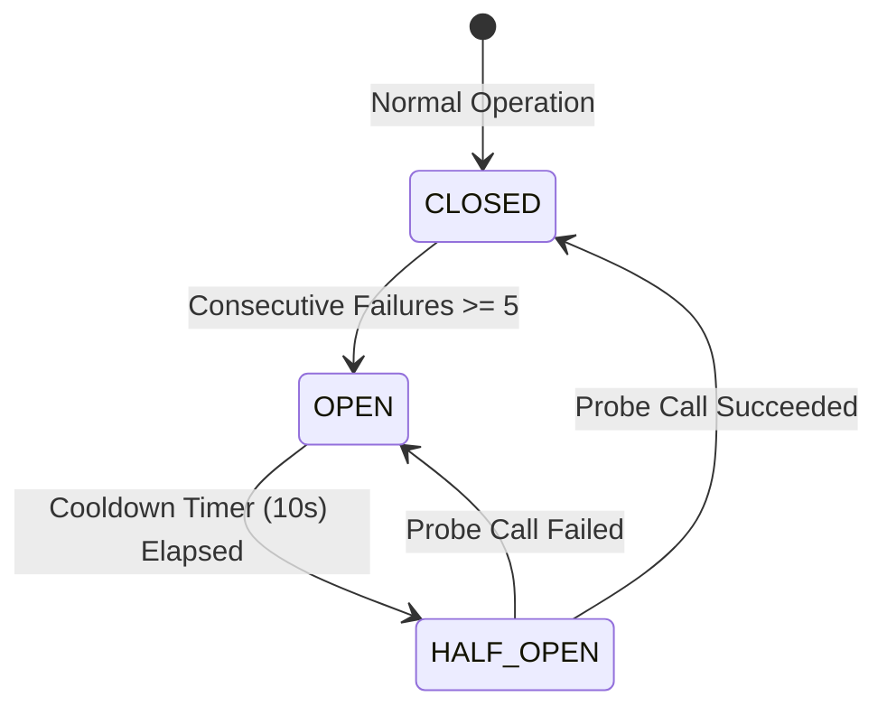
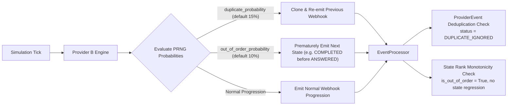

# Failure Handling & Chaos Resilience — NEXDIAL

## 1. Resilience Philosophy

In telecom-grade contact centers, failure is not an edge case — it is the expected operating environment. Telecom carriers disconnect without warning, workers crash while holding customer reservations, and network packets duplicate across transit boundaries.

NEXDIAL implements multi-layer defense mechanisms across all major failure modes.

---

## 2. Failure Recovery Protocols

---

## 3. Worker Crash & Multi-Phase Carrier Reconciliation

### The Scenario:
Agent reserved $\to$ Borrower reserved $\to$ Call initiated $\to$ **Worker process crashes before carrier dispatch completes or returns final bridge state.**

### The Problem:
1. **Orphaned Call Leakage:** If the reconciler resets agents to `AVAILABLE` without reconciling `Call` records, `Call` rows in `INITIATED` remain orphaned. The Safety Controller counts all `INITIATED` calls towards `in_flight_pending`, permanently depressing `safe_capacity` and starving the dialer.
2. **Double Allocation on Active Calls:** If the reconciler blindly resets agents to `AVAILABLE` while the carrier has an active call `RINGING` or `CONNECTED`, another worker will assign that agent to a new call, resulting in a borrower being abandoned when they answer!

### The NEXDIAL Recovery Engine (`WorkerPool.recover_worker_and_reconcile`):

#### Detailed Recovery Rules:
1. **Durable Worker Ownership:** Each call persists `worker_id` and `job_id`. The reconciler queries candidate calls using exact worker ownership as well as linked stale agent leases.
2. **Condition A (Never Initiated):** If `provider_call_id` is null or the carrier confirms `NOT_FOUND`, the call is transitioned to `CallState.FAILED` with `CallOutcome.WORKER_CRASH_ORPHANED`. The reserved agent is reset to `AVAILABLE` and borrower to `QUEUED`.
3. **Condition B (Carrier Active):** If the carrier confirms the call is active (`RINGING` or `CONNECTED`), the call and agent binding are strictly preserved. The agent is kept assigned to prevent double allocation.
4. **Condition C (Carrier Terminated):** If the carrier confirms the call completed while the worker was down, the call is finalized and the agent is returned to `AVAILABLE`.
5. **Condition D (Carrier Unreachable):** If the carrier status cannot be determined (timeout or outage), the agent and borrower are kept protected in their current state. Releasing them blindly would cause a race condition if the borrower is currently connected.
6. **Capacity Restoration:** Because resolved uninitiated calls transition to `FAILED`, [`SafetyController.get_system_capacity_snapshot()`](file:///D:/ML%20projects/NEXTDIAL-%20Intelligent%20Contact%20Center/backend/app/services/safety_controller.py#L36-L51) immediately stops counting them as `in_flight_pending`, restoring full safe capacity.

---

## 4. Telecom Circuit Breaker Specifications

- **Threshold:** 5 consecutive carrier handshake failures.
- **Cooldown:** 10.0 seconds.
- **Protection:** During `OPEN`, the Safety Controller rejects dials with `REJECT: Carrier circuit is OPEN`. Upstream carriers are never bombarded with retry storms.

---

## 5. Provider B Autonomous Webhook Anomalies

In production telecom environments, packet loss, carrier retry loops, and multi-path routing frequently deliver duplicate or out-of-order webhooks.

While Provider A provides an ultra-reliable baseline (75ms latency, 98% reliability), **Provider B** simulates a degraded, high-jitter telecom carrier with autonomous anomaly generation:

### Key Technical Properties:
1. **Configurable Probabilities:** `duplicate_event_probability` (0.0 to 1.0) and `out_of_order_probability` (0.0 to 1.0) can be configured via `POST /api/v1/providers/{provider_id}/configure-anomalies`.
2. **Deterministic Seed Support:** Tests pass `seed` to initialize `random.Random(seed)`, guaranteeing 100% deterministic assertion of duplicate drops and out-of-order handling without test flakiness.
3. **Clean Disable Mode:** When `autonomous_anomalies_enabled = False` (the default), zero anomalous events are scheduled or dispatched.
4. **Guaranteed Safety Controller Invariance:** Webhooks pass through [`EventProcessor.process_provider_event()`](file:///D:/ML%20projects/NEXTDIAL-%20Intelligent%20Contact%20Center/backend/app/services/telecom/event_processor.py#L40-L75). Deduplication ignores duplicate events, and monotonic state ranking (`STATE_RANK`) drops out-of-order regressions. Safety capacity and agent reservation integrity are never compromised.

---

## 6. Dynamic Predictive Setup Latency Clamping

Traditional predictive dialers that assume a static call setup window (e.g. fixed 10 seconds) fail catastrophically when carrier handshake latency spikes or network congestion delays phone ringing.

NEXDIAL implements dynamic setup latency telemetry in [`PacingEngine.get_dynamic_setup_latency()`](file:///D:/ML%20projects/NEXTDIAL-%20Intelligent%20Contact%20Center/backend/app/services/pacing_engine.py#L38-L92):

$$\tau_{\text{setup}} = \text{clamp}\left(2.0, 30.0, T_{\text{handshake}} + \bar{T}_{\text{ring}}\right)$$

### Telemetry Pipeline:
1. **Live Carrier Handshake ($T_{\text{handshake}}$):** Extracted from `provider.get_health()["avg_latency_ms"] / 1000.0`. Dynamically captures network latency spikes (e.g., jumping from 75ms on Provider A to 3500ms on Provider B).
2. **Rolling Average Ring Time ($\bar{T}_{\text{ring}}$):** Calculated from recently completed calls ($N \ge 3$) within a rolling 300-second window (`stale_telemetry_window_sec = 300.0`).
3. **Four Telemetry Classifications:**
   - `DYNAMIC_PROVIDER_AND_DB`: Both live carrier latency and sufficient recent call ring times are active.
   - `BLENDED_INSUFFICIENT_TELEMETRY`: Provider latency is active, but $<3$ recent calls exist; blends provider latency with default ring time (`8.0s`).
   - `STALE_TELEMETRY_FALLBACK`: Most recent call in DB is older than 300s; falls back to default `10.0s`.
   - `MISSING_TELEMETRY_DEFAULT`: Provider offline or no call history; safely falls back to default `10.0s`.
4. **Physical Clamping:** Enforces $\tau_{\text{setup}} \in [2.0\text{s}, 30.0\text{s}]$. Even under an extreme carrier latency spike (e.g., 45,000ms timeout), the dialer will never calculate an absurdly high agent release forecast that could risk borrower abandonment.
5. **Safety Controller Priority:** Regardless of the computed dynamic $\tau_{\text{setup}}$, dial batches must still receive explicit `APPROVE` or `REDUCE` authorization from `SafetyController`. The predictive algorithm cannot bypass this constraint.
