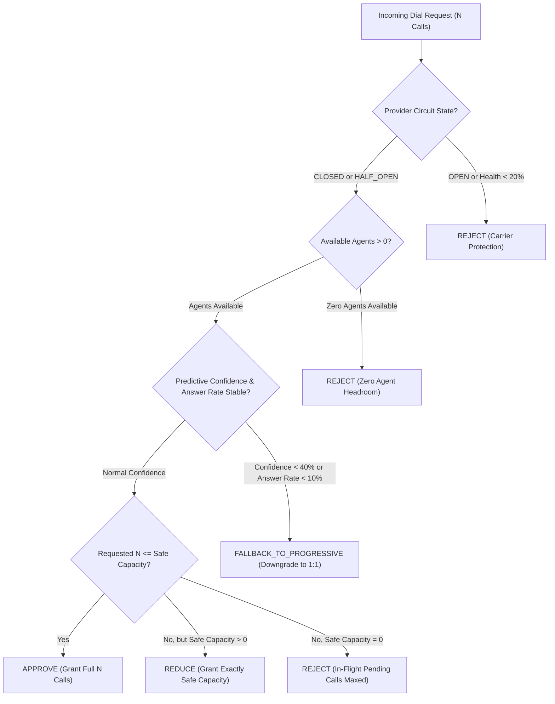

# Independent Safety Controller — NEXDIAL

## 1. Architectural Mandate

The Safety Controller is the **supreme gatekeeping authority** in the NEXDIAL platform. It sits between algorithmic pacing logic and the physical telecom provider layer.

### Invariant Rules:
1. **Never directly initiate calls from Pacing Engine:** The Pacing Engine can only submit a dial permission request.
2. **Zero Borrower Abandonment:** A borrower who answers a call must never experience dead air due to insufficient agent availability.
3. **Immutable Decision Auditing:** Every decision made by the Safety Controller is permanently recorded in the `safety_decisions` database table with the full capacity snapshot.

---

## 2. Decision Logic Taxonomy



---

## 3. Four Safety Decisions Explained

| Decision | Condition | Execution |
| :--- | :--- | :--- |
| `APPROVE` | $\text{Requested} \le \text{Safe Capacity}$ and Carrier is healthy. | Initiates all requested calls. |
| `REDUCE` | $\text{Requested} > \text{Safe Capacity} > 0$. | Initiates exactly $\text{Safe Capacity}$; cleanly suppresses remainder. |
| `REJECT` | $\text{Safe Capacity} \le 0$ OR Carrier Circuit is `OPEN`. | Rejects request in its entirety. Zero calls dispatched. |
| `FALLBACK_TO_PROGRESSIVE` | Predictive confidence degraded ($< 40\%$) or pickup collapse. | Automatically downgrades dialing ratio to strict 1:1 Progressive mode. |

---

## 4. Immutable Audit Record Schema

Every evaluation transaction generates an immutable database entry:

```sql
INSERT INTO safety_decisions (
    id, campaign_id, decision, requested_calls, approved_calls, rejected_calls,
    available_agents, reserved_agents, ringing_calls, active_calls,
    provider_health_score, reason, capacity_snapshot, provider_health_snapshot, created_at
) VALUES (...);
```
