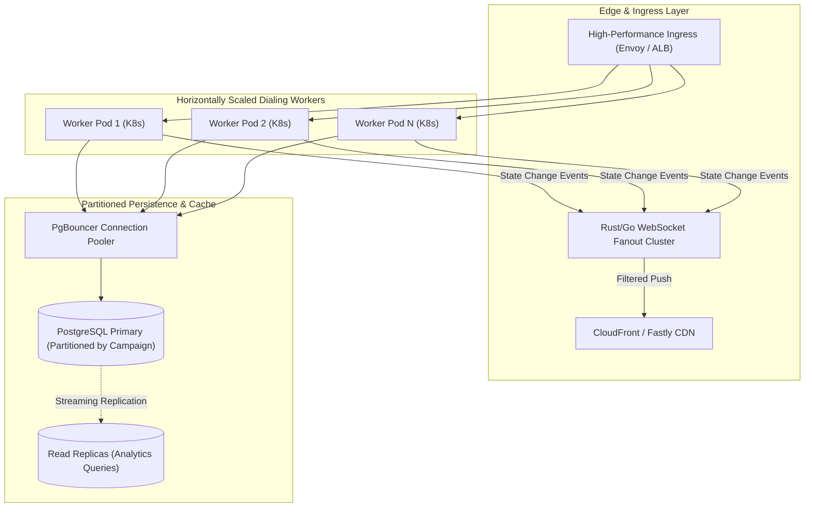

# Scaling Strategy & Bottleneck Analysis — NEXDIAL

## 1. Empirical Benchmark Analysis

Empirical load testing was executed on local test infrastructure across 100, 1,000, and 10,000 simulated agents.

| Scale Tier | DB Seed Latency (ms) | Allocation Throughput (ops/sec) | Avg Reservation Latency (ms) | Contention Race (Wins / Conflicts) | Event Processor (ops/sec) |
| :--- | :--- | :--- | :--- | :--- | :--- |
| **100 Agents** | 20.2 ms | 152.0 ops/s | 6.58 ms | 1 Win / 49 Conflicts | 114.2 ops/s |
| **1,000 Agents** | 64.0 ms | 121.9 ops/s | 8.20 ms | 1 Win / 49 Conflicts | 116.7 ops/s |
| **10,000 Agents** | 651.4 ms | 42.1 ops/s | 23.76 ms | 1 Win / 49 Conflicts | 113.0 ops/s |

---

## 2. What Breaks First at 10,000 Concurrent Agents?

### Bottleneck 1: Database Row Contention & Write Lock Serialization
- **The Issue:** At 10,000 agents, multiple worker threads concurrently executing `SELECT ... WHERE status = 'AVAILABLE'` followed by atomic updates cause row-lock contention on the relational index (`status, last_status_change`).
- **Mitigation:**
  - Partition the `agents` table by `campaign_id` or `team_id`.
  - Implement `SKIP LOCKED` (`SELECT id FROM agents WHERE status = 'AVAILABLE' FOR UPDATE SKIP LOCKED LIMIT 10`) in PostgreSQL, allowing concurrent workers to bypass already-locked rows without blocking.

### Bottleneck 2: WebSocket Fan-out Overhead
- **The Issue:** Broadcasting every call transition (`INITIATED`, `RINGING`, `CONNECTED`, `COMPLETED`) to all connected frontend operators consumes high CPU in Python's async event loop when hundreds of operators are viewing real-time operations.
- **Mitigation:**
  - Implement **Telemetry Throttling & Batching** (e.g. 250ms batching windows).
  - Offload WebSocket pub/sub to an external gateway (e.g. Redis Pub/Sub with a dedicated Go or Rust WebSocket edge server).

### Bottleneck 3: Database Connection Pool Exhaustion
- **The Issue:** Hundreds of concurrent dialing workers attempting to open persistent database connections will exceed PostgreSQL's `max_connections`.
- **Mitigation:**
  - Deploy **PgBouncer** in transaction pooling mode.

---

## 3. High-Scale Evolution Path (10,000 to 100,000 Agents)

